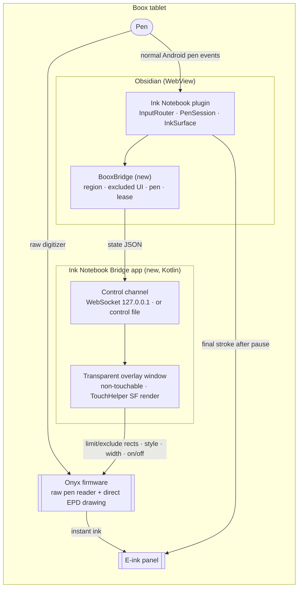
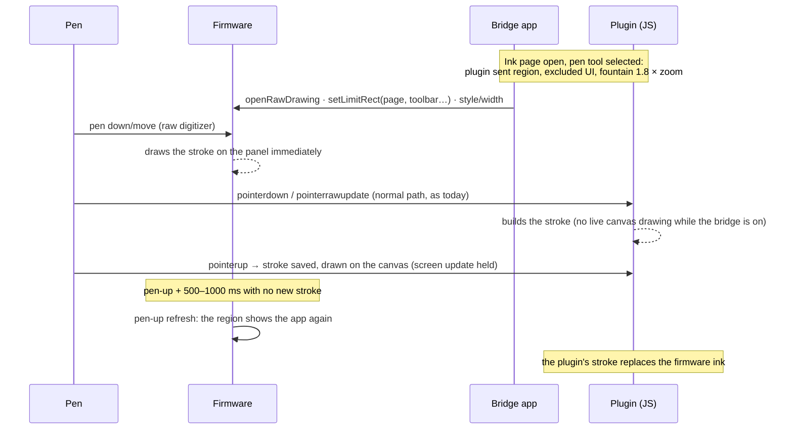

# Plan: Boox Notes–speed ink in Ink Notebook

**Goal:** writing on an ink page in Obsidian on an Onyx Boox shows the ink as fast as the Boox Notes app does.

**Answer in one line:** a small companion Android app ("Ink Notebook Bridge") turns on Onyx's *firmware* pen drawing over the ink page, and the plugin tells it where the page is, which pen is selected and when to stop. The firmware paints the ink straight onto the e‑ink panel, which is the same path Boox Notes uses, so the latency is the same by construction. The plugin keeps receiving the pen exactly as today, saves the real stroke and replaces the firmware ink with its own drawing when you pause.

## Status (November 2026)

**Built:** Phases 1 and most of 2.
- The Bridge app is in `android/`. It is built against Onyx's real SDK, and CI attaches its APK to every release.
- The plugin side is `src/core/fastInk.ts` and `src/obsidian/fastInkBridge.ts`, plus the hooks in the pen engine, and *Settings → Instant ink on Boox*.

**Verified without a Boox:**
- **Kotlin unit tests (14):** protocol, calibration, vault discovery, and the real WebSocket server, which accepts Obsidian's origins and rejects a website's.
- **Contract test:** a message produced by the plugin's own code is read by the app's parser.
- **Plugin tests (270):** all of them, including the instant ink messages.
- **End-to-end test (`dev/fastink-e2e.cjs`):** the real plugin (surface, toolbar, bridge) runs in Chromium as `http://localhost`, with real pen input, connected to the real Bridge control code on the JVM. All 17 checks pass. They cover:
  - the page placed from the guess, then measured from the first stroke
  - the plugin still recording the stroke
  - the open pen card left out of the drawing area
  - lasso and highlighter stopping it
  - pen style, colour and width following the pen and the zoom
  - an Obsidian modal and a sidebar over the page stopping it
  - hold‑to‑snap clearing the firmware's line
  - the firmware stopping when the plugin goes away

**First tests on a Boox Note Air 6C (November 2026):**
- The plugin and the Bridge connect through the control file. Obsidian blocks the direct connection, as expected.
- The plugin asks for instant ink, and the Bridge turns it on.
- With Onyx's pen SDK 1.4.11 (what Boox Rapid Draw uses), the firmware's pen reader reported the pen only as hovering, never as touching. That happened even in the Bridge's whole-screen self-test, so no firmware ink appeared. The 1.4.11 reader finds the digitizer by three fixed names and is older than this tablet.
- Bridge 0.3.0 moves to SDK 1.5.9 (November 2026), whose pen reader was rewritten.
- **With Bridge 0.4.0 (SDK 1.5.9), all three whole-screen self-tests drew ink on the Note Air 6C.** That includes test 1, the firmware's own reader, which is the path instant ink uses.
- **In Obsidian with Bridge 0.4.0, the Ink Notebook page shows instant ink on the Note Air 6C:** the firmware draws the line right under the pen tip, and the plugin records the stroke. Two bugs remained:
  - The whole drawing flashed after each stroke, because the Bridge turned the firmware's layer off at pen-up, as Rapid Draw does.
  - After a colour or size change, instant ink took a while to come back, because pen-hover reports flooded the Bridge's main thread with firmware calls.
- Bridge 0.5.0 fixes both: it repaints only the stroke's area at pen-up, and coalesces the hover reports.

**Still to do on a tablet:**
- The firmware call itself (`TouchHelper` drawing), which nothing but a Boox can run.
- Which transport Obsidian allows (the socket or the file).
- How the firmware's pen styles compare with the plugin's.
- The refresh after lifting the pen.

Boox Rapid Draw users report the same firmware path working over Obsidian, so the risk is in the details, not in the approach.

**Differences from the plan below, as built:**
- The plugin keeps drawing live during the stroke, as it does with Rapid Draw. Skipping it is an optimisation for after the device test.
- Leases are 6 s (socket) and 10 s (file), renewed every 2 s and 4 s.
- The plugin writes nothing and opens no connection until the Bridge's status file has appeared (or instant ink is set to *Always on*).

---

## 1. Why the lag exists, and why this fixes it

| Path | What happens between the pen moving and ink appearing |
| --- | --- |
| **Ink Notebook today** | digitizer → Android input → WebView → JavaScript draws on a canvas → Chromium composites → Android SurfaceFlinger → e‑ink controller refresh |
| **Boox Notes** | digitizer → Onyx's native pen reader → **the firmware draws the stroke directly on the panel** with a fast waveform. The app gets the points afterwards |
| **This plan** | same as Boox Notes for what you *see*. The plugin still gets the normal pen events in parallel and draws the stroke for real afterwards |

The JavaScript part is already small (see `src/ink/tools.ts` `PenSession`, `src/ink/surface.ts` `drawLive`). Most of the delay is everything after it, which no plugin code can skip. Only the firmware path skips it.

## 2. Evidence that it works

1. **Onyx's pen SDK is public.** It is `com.onyx.android.sdk:onyxsdk-pen` on `repo.boox.com`, published for third‑party developers, so nothing needs decompiling. I inspected version 1.4.11's public API:
   - `TouchHelper.create(view, FEATURE_SF_TOUCH_RENDER /* 2 */, callback)`, `openRawDrawing()`, `setRawDrawingEnabled()`, `setRawDrawingRenderEnabled()`
   - `setLimitRect(rect, excludeRects)` for the drawing region and the parts left out of it
   - `setStrokeStyle()` (`PENCIL 0`, `FOUNTAIN 1`, `MARKER 2`, `NEO_BRUSH 3`, `CHARCOAL 4`, `DASH 5`, `CHARCOAL_V2 6`), `setStrokeWidth()`, `setStrokeColor()`
   - `setPenUpRefreshTimeMs()`, `setPenUpRefreshEnabled()`, `enableSideBtnErase()`, `setPostInputEvent()`

   Underneath, a native reader (`libonyx_pen_touch_reader.so`) reads the pen device directly. The firmware is driven through `EpdController.setScreenHandWritingRegionLimit / RegionExclude / PenState / setStrokeStyle / setStrokeWidth / setStrokeColor`.

2. **Drawing over another app already works.** [Boox Rapid Draw](https://github.com/sergeylappo/boox-rapid-draw) (MIT licence) is a foreground service that adds a full‑screen, transparent, *non‑touchable* `TYPE_APPLICATION_OVERLAY` window. It attaches a `TouchHelper` with `FEATURE_SF_TOUCH_RENDER` and turns raw drawing on (`OverlayShowingService.kt`). Its author says it "does not intercept [pen events], only listens to [them]" ([#28](https://github.com/sergeylappo/boox-rapid-draw/issues/28)). So the app underneath still gets the pen.
3. **People already use it over Obsidian.** Users run it with the Obsidian Ink and Excalidraw plugins ([#29](https://github.com/sergeylappo/boox-rapid-draw/issues/29), [#26](https://github.com/sergeylappo/boox-rapid-draw/issues/26)). Their complaints are exactly the gaps this plan closes:
   - It draws over Obsidian's buttons, so "ui elements become non selectable" ([#34](https://github.com/sergeylappo/boox-rapid-draw/issues/34)). Fix: the plugin sends the drawing region and leaves out the toolbar.
   - It uses one fixed pen (3 px pencil). Fix: the plugin sends the selected pen.
   - The final stroke differs from the fast ink. Fix: matching pen styles, and the swap happens only when you pause.
4. **Recent devices work.** It works on Android 14/15 devices such as the Note Air 5C once the foreground‑service permissions are declared ([PR #33](https://github.com/sergeylappo/boox-rapid-draw/pull/33)).

## 3. What was ruled out

| Idea | Why not |
| --- | --- |
| Plugin only, with no companion app | A plugin is JavaScript in Obsidian's WebView. It can't load Java or native code, and Obsidian's Capacitor bridge only exposes a fixed set of built‑in native plugins |
| WebAssembly | Same sandbox as JavaScript. It speeds up computation, not the display path |
| Patching or repackaging the Obsidian APK | Breaks Obsidian's licence and its updates, and needs re‑signing |
| Embedding the Boox Notes app | Android can't show another app's screen inside Obsidian, and Notes' data is private and undocumented |
| Boox "Handwriting Optimization" (App Optimization → Scribble) | Worth trying in Phase 0, but there is no control over region or pen. It is documented for OneNote, Evernote and WPS and may not apply to Obsidian |

---

## 4. Architecture



### What happens during one stroke



If the plugin decides the stroke was not ink (a tap on a link chip, hold‑to‑snap turned it into a shape, scribble‑to‑erase), it sends `clear` and the firmware ink goes away at once.

---

## 5. The pieces

### 5.1 Companion app: "Ink Notebook Bridge" (new, `android/` in this repo)

Start from Boox Rapid Draw (MIT, keep its notice) and change it:

- **Run only on request.** A foreground service (`specialUse`) holds the overlay. Raw drawing is **closed** (`closeRawDrawing`) unless the plugin holds a live lease. This also avoids Rapid Draw's palm‑rejection side effect ([#30](https://github.com/sergeylappo/boox-rapid-draw/issues/30)), because nothing is left switched on.
- **The overlay** is a full‑screen `SurfaceView` in a `TYPE_APPLICATION_OVERLAY` window with `FLAG_NOT_TOUCHABLE | FLAG_NOT_FOCUSABLE` and window `alpha ≤ 0.8`. Android 12+ only lets touches pass through overlays below 0.8. Fingers, the keyboard and Obsidian's UI keep working.
- **Control channel**, two transports, the plugin uses whichever connects:
  1. **WebSocket on `127.0.0.1`** (preferred: instant, two‑way, and a closed socket means "stop"). Whether Obsidian's Android WebView allows plain `ws://` to the loopback address depends on its cleartext policy, which I couldn't check from here. Phase 0 tests it.
  2. **Control file** `<vault>/<configDir>/plugins/ink-notebook/bridge/state.json`, written by the plugin and watched by the companion (`FileObserver`, with a 100 ms poll as backup). This needs no network permission. It needs the vault in shared storage and the companion to have file access ("All files access", or the vault folder picked once).
- **State machine:** `off` → `armed` (region set, raw drawing open) → `paused` (a modal or menu is open, or a tool other than pen) → `off` when the lease runs out.
- **Applying state:** `setStrokeStyle`, `setStrokeWidth`, `setStrokeColor`. Region changes use the close → `setLimitRect(limit, excludes)` → open sequence the SDK needs, and `setPenUpRefreshTimeMs(refreshMs)`. `clear` calls `setRawDrawingRenderEnabled(false)` and re‑enables on the next `onPenActive`, which is what Rapid Draw does.
- **Calibration:** CSS px → overlay px. The plugin sends `devicePixelRatio`. For the first strokes after connecting, it also sends the client position of each pen‑down. The companion matches them with `onBeginRawDrawing` points and stores the offset (status bar, split screen).
- **Safety:** it accepts only connections from `127.0.0.1`, uses a token from the control file, and closes raw drawing when the lease expires (3 s) or the screen turns off.
- **Licence:** MIT, as a separate program talking to the plugin over IPC. That keeps the proprietary Onyx SDK out of the AGPL plugin.

### 5.2 Plugin side (changes to this repo)

| Where | Change |
| --- | --- |
| `src/obsidian/booxBridge.ts` (new) | Connects (WebSocket, else control file), sends state, renews the lease every 1 s while the ink view is visible, sends `off` on `visibilitychange`/`pagehide`/view close, reports status |
| `src/ink/surface.ts` | `fastInkState()`: the canvas rect, the rects of all `.ink-ui` elements over it (toolbar, popovers, selection bar, library panel, text editor), and the pen width in screen px (`width × view.scale × dpr`). Sent on `resize()` (line ~363), `setView()` (~426) and `setTools()` (~730) |
| `src/ink/tools.ts` `PenSession` | While the bridge is armed, skip `beginLive`/`drawLive` during the stroke and draw once at pen‑up. The firmware already shows the ink, and drawing it again only costs CPU. Send `clear` when hold‑to‑snap (~177) or scribble‑erase (~213) changes the stroke |
| `src/ink/input.ts` | Send `clear` after a pen tap opens a link chip. Send the calibration pen‑downs |
| Pen mapping | fountain → `FOUNTAIN`, calligraphy → `FOUNTAIN`, ballpoint → `PENCIL`, pencil → `CHARCOAL_V2`, brush → `NEO_BRUSH`, highlighter → `MARKER` or off, depending on how it looks (Phase 2). Colours as ARGB, black on mono screens |
| Pause rules | Paused for lasso, shapes, text, fill and the object library tool. Also paused while an Obsidian `.modal-container`, `.menu`, `.suggestion-container` or the keyboard is up (`MutationObserver` on `body`, `visualViewport` resize) |
| `src/settings.ts` + settings tab | "Boox fast ink: Automatic / On / Off", connection status, "Get the Bridge app" link, transport in use, refresh delay after lifting the pen (default 800 ms) |
| `src/obsidian/setupWizard.ts` | On a Boox, offer the Bridge app with step‑by‑step permission instructions |

Without the companion app, nothing changes: the plugin works as it does today.

### 5.3 Protocol (JSON, version 1)

```json
{ "v": 1, "type": "state", "seq": 42, "token": "…", "lease": 3000,
  "armed": true, "dpr": 2,
  "region":  { "x": 0, "y": 56, "w": 1240, "h": 1600 },
  "exclude": [ { "x": 0, "y": 0, "w": 1240, "h": 56 }, { "x": 900, "y": 70, "w": 320, "h": 400 } ],
  "pen": { "style": "fountain", "width": 4.2, "color": "#000000" },
  "refreshMs": 800 }
{ "v": 1, "type": "clear" }
{ "v": 1, "type": "calibrate", "cx": 512.5, "cy": 300.25, "t": 123456.7 }
```

Rects are CSS px relative to the WebView. The companion owns the conversion to screen px.

---

## 6. Phases

### Phase 0: confirm it on your tablet (no code, about 20 minutes)
1. Note the model, Android version and firmware version (Settings → About).
2. Try Boox's own **App Optimization → Scribble → Handwriting Optimization** for Obsidian, if your firmware shows it for Obsidian. Write on an ink page.
3. Install **Boox Rapid Draw** from its GitHub releases. Grant "Display over other apps", start it and write on an Ink Notebook page.
   - Expected: instant pencil ink, and the stroke is still saved by the plugin (flip to the Text page or reopen the page to check).
   - Also expected: taps on the toolbar draw ink or misbehave (#34), and the ink style differs from the final stroke.
4. Send me what you saw. Whether `ws://127.0.0.1` works is checked by the first Phase 1 build, which reports the transport it ended up using in the settings.

**Pass:** instant ink while the plugin still records the strokes. Then everything else is engineering. If it fails on your device, the issue reports above show what to look for.

### Phase 1: minimum Bridge (about 1–2 weeks)
- `android/` Kotlin project: overlay service, TouchHelper SF render, both transports, lease, `state`/`clear`.
- `booxBridge.ts`: region (whole ink view), toolbar excluded, pen tool on/off, lease, status in settings.
- **Exit:** pen tool gives instant ink, toolbar and Obsidian UI work normally, leaving Obsidian or opening a menu stops the fast ink within 1 s.

### Phase 2: make it feel identical (about 1–2 weeks)
- Pen style, width and colour mapping with zoom. Tune the refresh delay after lifting the pen.
- `clear` for link taps, hold‑to‑snap and scribble‑erase. Skip live canvas drawing while armed.
- All plugin popovers, the library panel and the text editor excluded. Obsidian modals, menus and the keyboard pause it.
- Rotation, split screen, sleep and wake, page turns, zoom and pan (fingers keep working because the overlay is not touchable).
- Calibration.
- **Exit:** a full page of handwriting with no visible lag, no ink over UI, and no visible jump when the final stroke replaces the fast ink.

### Phase 3: ship it (about 1 week)
- GitHub Actions builds and signs the APK. `release.yml` attaches it to each plugin release.
- Setup wizard and settings guide the install. README section.
- Test matrix: Note Air (Android 10/11), Note Air 3 (12), Note Air 4/5 C (13–15), Tab Ultra, Go 10.3. Colour (Kaleido) devices for colours.

### Phase 4: extras
- Lasso loop drawn instantly with the `DASH` style.
- Eraser feedback (`setEraserRawDrawingEnabled`), side‑button erase via `enableSideBtnErase`.
- Fast ink for the PDF annotation pages.

---

## 7. Risks and what to do about them

| Risk | Mitigation |
| --- | --- |
| Obsidian's WebView blocks `ws://127.0.0.1` (cleartext policy) | The control file transport. It is slower (about 50–150 ms per change) but changes only happen when you tap the toolbar, never mid‑stroke |
| The vault is in Obsidian's app‑private storage, which another app can't read | Detect it and ask to move the vault to shared storage, or write the control file through Obsidian's Capacitor Filesystem to `Documents/` if available |
| Firmware differences (Android 10 → 15, "regal" refresh mode, [#20](https://github.com/sergeylappo/boox-rapid-draw/issues/20)) | Phase 0 on your device first, then the Phase 3 matrix. Fall back to the plugin's own drawing whenever the Bridge reports an error |
| Fast ink shows over an Obsidian popup the plugin didn't see | Pause on any new top‑level element (`MutationObserver`). Keep the lease short |
| Fast ink and final stroke look different | Style mapping. The swap only happens after you pause (refresh delay), like in Boox Notes |
| Rapid Draw's known issues: keyboard handwriting ([#26](https://github.com/sergeylappo/boox-rapid-draw/issues/26)), notification shade freeze ([#15](https://github.com/sergeylappo/boox-rapid-draw/issues/15)) | Raw drawing is open only over the ink page, so the keyboard and shade are outside the region or paused |
| Obsidian community plugin rules | The plugin only talks to a local socket or file and links to the APK. It downloads and runs nothing itself |
| It is two installs, not one plugin | Unavoidable: native code can't come from a plugin. Without the Bridge, the plugin keeps working as before |

---

## 8. Sources

- Onyx pen SDK: `repo.boox.com/repository/maven-public/com/onyx/android/sdk/onyxsdk-pen` (public API inspected from 1.4.11; the latest is 1.5.9)
- [Boox Rapid Draw source](https://github.com/sergeylappo/boox-rapid-draw), issues [#26](https://github.com/sergeylappo/boox-rapid-draw/issues/26), [#28](https://github.com/sergeylappo/boox-rapid-draw/issues/28), [#29](https://github.com/sergeylappo/boox-rapid-draw/issues/29), [#30](https://github.com/sergeylappo/boox-rapid-draw/issues/30), [#34](https://github.com/sergeylappo/boox-rapid-draw/issues/34), [PR #33](https://github.com/sergeylappo/boox-rapid-draw/pull/33)
- [The eBook Reader: Boox Rapid Draw](https://blog.the-ebook-reader.com/2024/10/11/boox-rapid-draw-can-decrease-writing-latency-on-3rd-party-apps/)
- [Boox: optimize OneNote, Evernote and WPS (Handwriting Optimization)](https://shop.boox.com/en-ca/blogs/news/optimize-onenote-evernote-wps)
- [Unofficial Onyx SDK docs (TouchHelper lifecycle)](https://progressive-kiwi.github.io/onyx-inking-unofficial-docs/touchhelper-api.html)
- [Obsidian forum: plain‑HTTP loads on Android (cleartext)](https://forum.obsidian.md/t/external-images-over-http-dont-load-on-android-preview/27000), and Obsidian mobile's origin `http://localhost` ([forum](https://forum.obsidian.md/t/is-it-possible-to-change-origin-header-sent-within-http-request-from-mobile-app/68970))
- [Readest: WebView app with Onyx raw drawing](https://github.com/readest/readest/pull/6674) (merged, but the Boox path was untested on a pen device)
